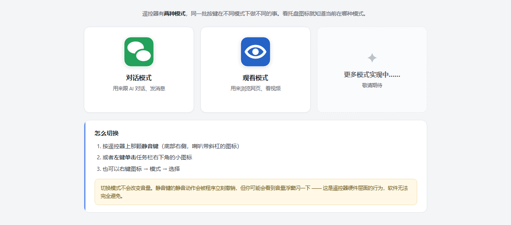
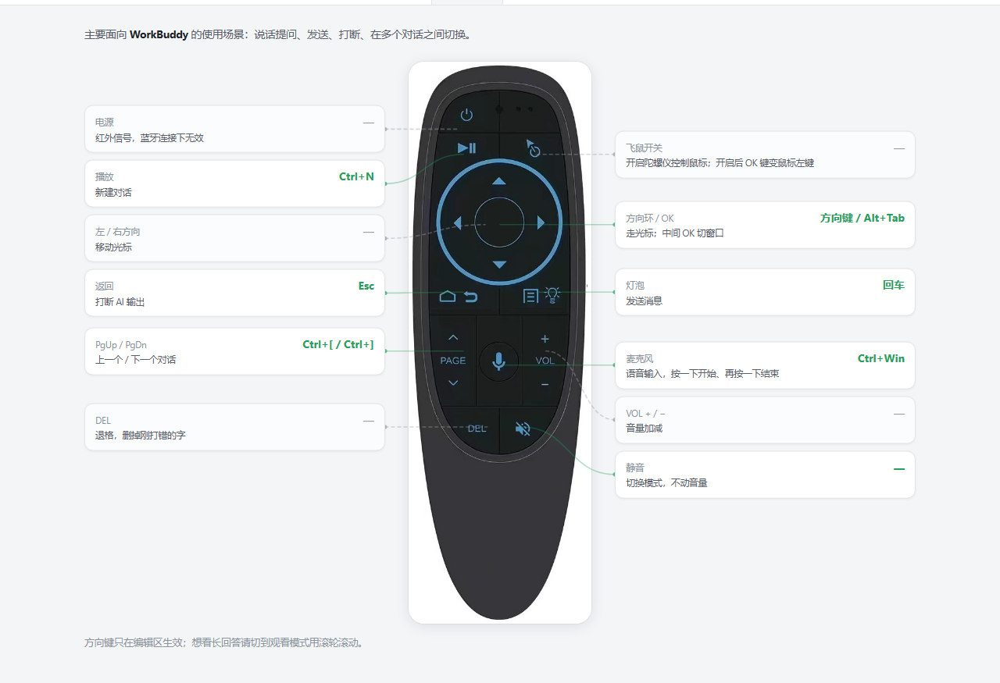
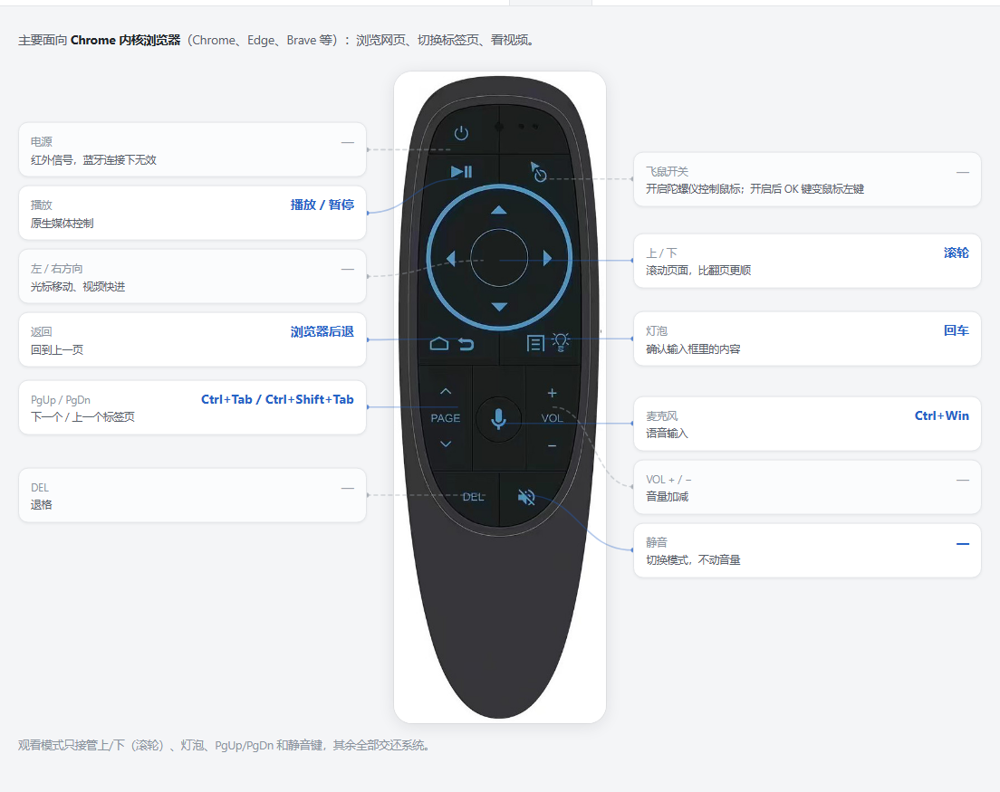

# G10S Pro 遥控器按键说明

把一支 2.4G 飞鼠遥控器改造成电脑上的两用输入设备：**对话模式**面向 AI 对话客户端（WorkBuddy），**观看模式**面向 Chrome 内核浏览器。

**按住「返回」键不放 = 鼠标右键**（两个模式都生效）；单击仍是 Esc / 浏览器后退。

> 带遥控器图解和连线的说明书页：双击托盘图标，或右键 →「按键说明…」打开。页内有「版本日志」页签。

## 模式切换

## 对话模式

## 观看模式

## 下载

**[⬇ 下载最新版（Windows 64 位，单文件免安装）](https://github.com/rfHu/g10s-remote/releases/latest)**

包名带版本号（`G10S-Remote-v<版本>.exe`）。每个版本改了什么，看 [版本日志](CHANGELOG.md) 或 Release 页。

## 技术细节

想了解实现原理和实测数据，看这些文档：

- [G10S-Pro 按键对照表](docs/G10S-Pro-按键对照表.md) —— 全键实测值、OK 键双身份、实现说明
- [遥控器实测结果](docs/遥控器实测结果.md) —— 设备身份（型号 ZTKA-IR57、PID 0x9451）
- [遥控器改造指南](docs/遥控器改造指南.md) —— 早期调研，含谷歌遥控器的 ATVV 协议
